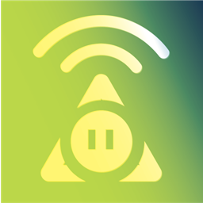

<p align="center">
  
</p>
<h1 align="center">OunceChiaki</h1>

<p align="center">A minimal PlayStation Remote Play client for Nintendo Switch 2, for <a href="https://github.com/ouncebrew">kaiHEN</a>. Streams a PS4 or PS5 on your local network with the low-latency behavior of CivChiaki (<a href="docs/STREAMING.md">how it streams</a>).</p>

> [!WARNING]
> This is an unofficial project, not endorsed or certified by Sony Interactive
> Entertainment LLC. You must own a PS4 or PS5.

## Features

- **Low-latency LAN streaming** up to 1080p60 with the Switch 2 hardware H.264
  decoder (no PSN sign-in or internet relay).
- **Frame generation (30→60 or 60→120 fps):** GPU motion estimation doubles the
  display rate to match the 120 Hz screen, with **Extrapolate** (default, low
  latency) and **Interpolate** (smoother, half a frame of added delay) modes.
- **Full controller support:** DualSense-style motion (gyro and accelerometer),
  touchscreen as a two-finger touchpad with tap-to-click, HD rumble (plus PS5
  haptics), and voice chat via the console's microphone.
- **Quick menu over the stream** (Home button): time, Wi-Fi and battery, live
  stream stats, microphone toggle, screen brightness and auto-brightness,
  **Disconnect**, and **Disconnect and sleep**.
- **LAN discovery and wake-on-connect:** finds consoles automatically (or add
  by IP) and wakes paired consoles from rest mode when you connect.

*Tested on PS5; PS4 support is implemented but untested.*

## Install and pair

1. Download `OunceChiaki.nro` from the [releases](../../releases) and copy it
   to `/switch/OunceChiaki/` on the SD card (settings and logs live there).
2. Enable Remote Play on your console and open the pairing screen:
   - **PS5:** Settings → System → Remote Play → Pair Device
   - **PS4:** Settings → Remote Play Connection Settings → Add Device
3. In OunceChiaki, pick your console under **Add a console** (or **Add console
   by address** if discovery doesn't find it) and press **A**.
4. Enter your 12-character Base64 PSN account ID (ending in `=`, not your
   online ID) and the 8-digit pairing PIN shown on the console.

Once paired, the console appears at the top of the list. Press **A** to stream
(or wake from rest mode and connect) and **Y** to remove a saved console.

## Controls

The buttons map by position, as on a PlayStation controller.

| Switch | PlayStation |
|---|---|
| B / A / Y / X | Cross / Circle / Square / Triangle |
| L / R, ZL / ZR | L1 / R1, L2 / R2 |
| Plus | Options |
| Minus, or a tap on the screen | Touchpad click |
| Touchscreen | Touchpad (one or two fingers) |
| Chat (C) | PS button |
| Capture | Create / Share |
| Home | Quick menu (B or Home: back to the game) |
| Motion | The controller's gyro and accelerometer |

## Settings

- **Stream:** resolution (up to 1080p), frame rate (30 or 60 fps), **Frame
  generation** toggle with **Extrapolate** / **Interpolate** mode, bitrate
  (Auto or fixed), and **Force low-latency audio**.
- **Controller:** motion controls, touchscreen as touchpad, and rumble strength
  (Off, Weak, Normal, Strong — Weak by default).

## Build

Needs Docker. See [AGENTS.md](AGENTS.md) for details.

```sh
scripts/init-submodules.sh
scripts/build.sh   # -> build/switch2/OunceChiaki.nro
```

## Credits

- [chiaki-ng](https://github.com/streetpea/chiaki-ng) (Street Pea and the Chiaki
  contributors, originally [Chiaki](https://git.sr.ht/~thestr4ng3r/chiaki) by
  Florian Märkl): the Remote Play protocol.
- [Moonlight-Switch](https://github.com/XITRIX/Moonlight-Switch) and
  [Borealis](https://github.com/XITRIX/borealis) by XITRIX: Switch 2 video,
  audio and UI.
- [ouncebrew](https://github.com/ouncebrew): libounce, OunceVK and kaiHEN.

## Licence

GNU AGPL 3.0, as chiaki-ng (see [COPYING](COPYING)). If you distribute builds,
provide the corresponding source.
